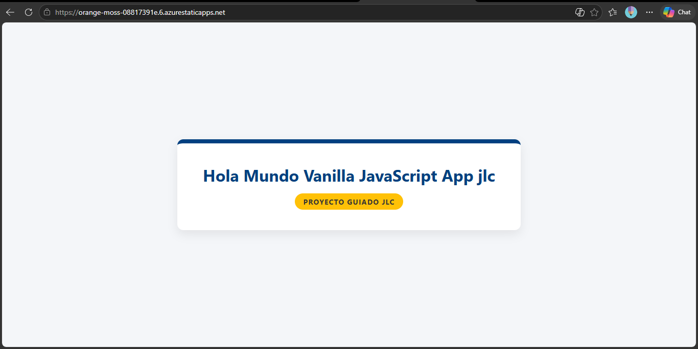
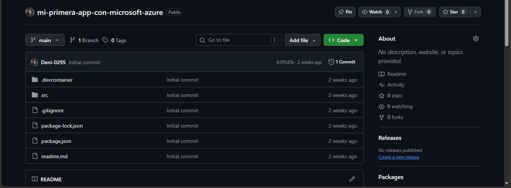
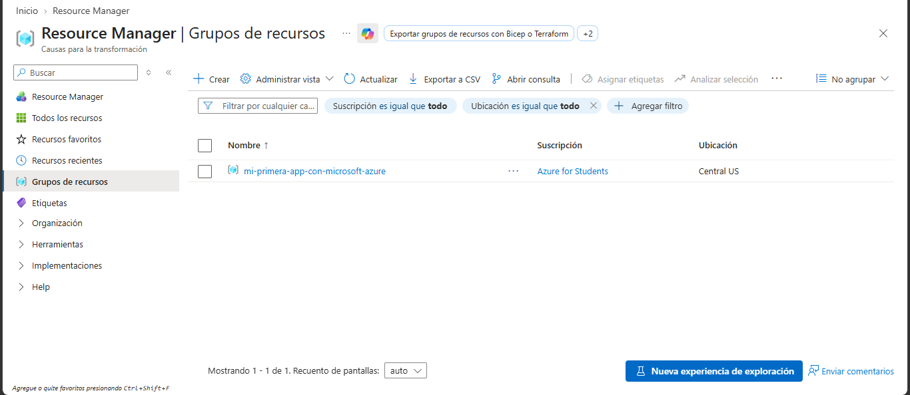

# Mi primera app web en Azure Static Web Apps

Laboratorio del curso **Fundamentos de Ciberseguridad con Tecnologías Microsoft** (INFOTEC).
Despliegue de una aplicación web estática en Azure, conectada a GitHub, con actualización automática en cada commit.



## Qué hice
- Creé este repositorio a partir de la plantilla **Vanilla** (JavaScript puro).
- Configuré Git y cloné el repositorio de forma local.
- Creé una **Azure Static Web App** desde Visual Studio Code.
- Edité `index.html`, hice *commit* y sincronicé; el cambio se reflejó solo en producción.

## Tecnologías
Azure Static Web Apps · GitHub · Git · Visual Studio Code · HTML/JavaScript

## Pasos

1. **Repositorio desde plantilla:** creé el repositorio público con la plantilla Vanilla de Static Web Apps.
2. **Configurar y clonar:**
   ```bash
   git config --global user.name "[tu usuario de GitHub]"
   git config --global user.email "[correo de tu GitHub]"
   git clone https://github.com/[TU-USUARIO]/[NOMBRE-DEL-REPO].git
   ```
3. **Crear el recurso en VS Code** (`Ctrl+Shift+P` → *Create Static Web App*):
   - Región: la más cercana disponible
   - Framework: **Custom**
   - Ubicación de la app: `/source`
   - Ubicación de compilación: `/source`
4. **Verificar:** *Browse Site* abre la aplicación publicada.
5. **Actualizar:** editar `source/index.html` → guardar → *Commit* → *Sync Changes*. El cambio aparece en producción en ~1-2 minutos.

## Capturas
| Paso | Captura |
|---|---|
| Repositorio creado |  |
| Recurso en Azure |  |

## Lo que aprendí
- Diferencia entre una Web App y una Static Web App (frontend sin base de datos).
- Ciclo de trabajo con control de versiones: editar → commit → sincronizar.
- Despliegue automático (CI/CD) entre GitHub y Azure.
> Nota: el sitio en vivo funcionó durante el curso y el recurso puede ya no estar activo. Las capturas muestran el resultado.
Copyright (c) 2026 Irma (Deni-0295). Todos los derechos reservados.

Este repositorio y su contenido (reportes, documentos, imágenes y textos)
son propiedad de la autora. No se permite copiar, modificar, distribuir
ni utilizar este material, total o parcialmente, sin autorización
previa y por escrito.

# Vanilla JavaScript App

[Azure Static Web Apps](https://docs.microsoft.com/azure/static-web-apps/overview) allows you to easily build JavaScript apps in minutes. Use this repo with the [quickstart](https://docs.microsoft.com/azure/static-web-apps/getting-started?tabs=vanilla-javascript) to build and customize a new static site.

This repo is used as a starter for a _very basic_ HTML web application using no front-end frameworks.

This repo has a dev container. This means if you open it inside a [GitHub Codespace](https://github.com/features/codespaces), or using [VS Code with the remote containers extension](https://code.visualstudio.com/docs/remote/containers), it will be opened inside a container with all the dependencies already installed.
- Una Static Web App consume muchos menos créditos que un recurso con base de datos.
